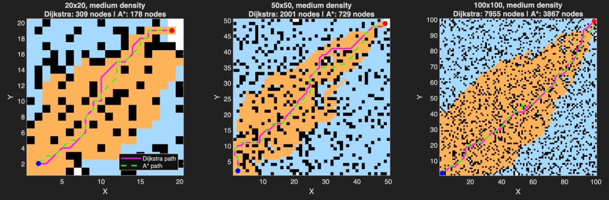
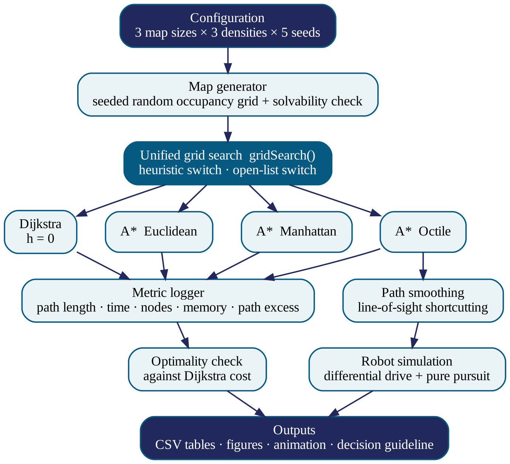
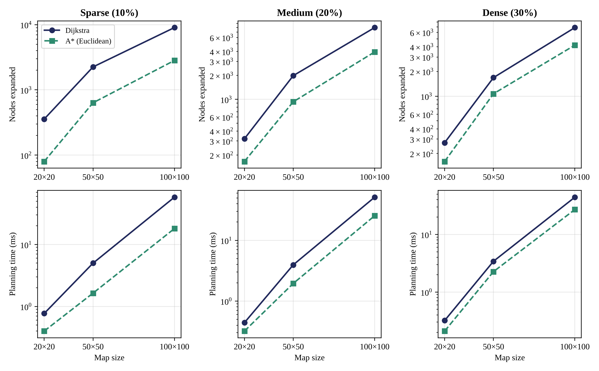
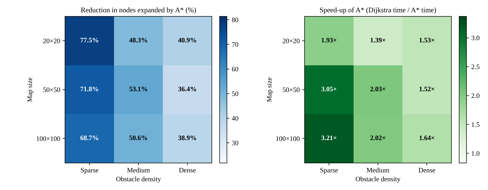
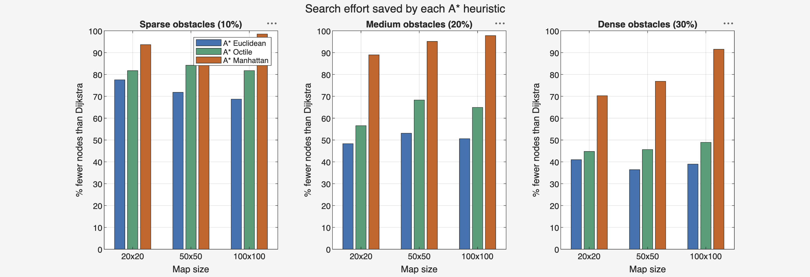
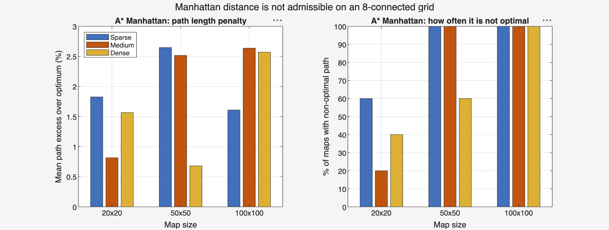
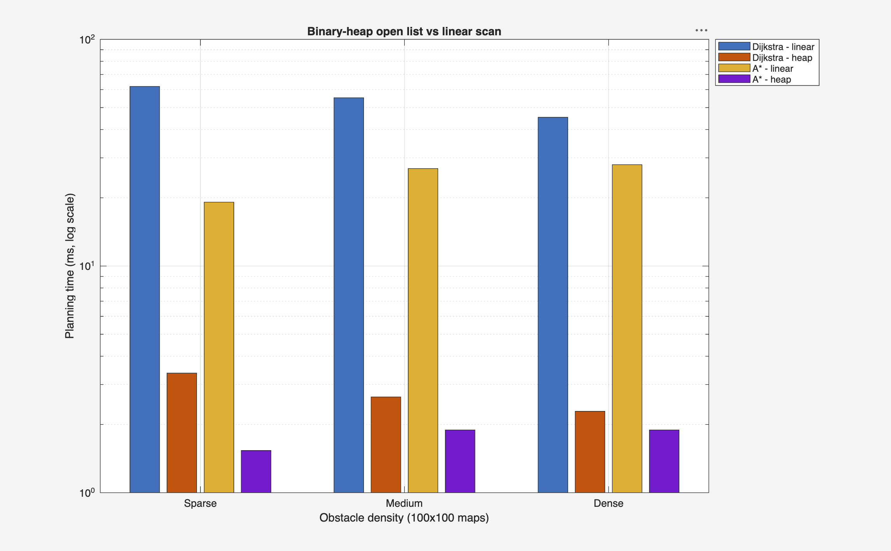
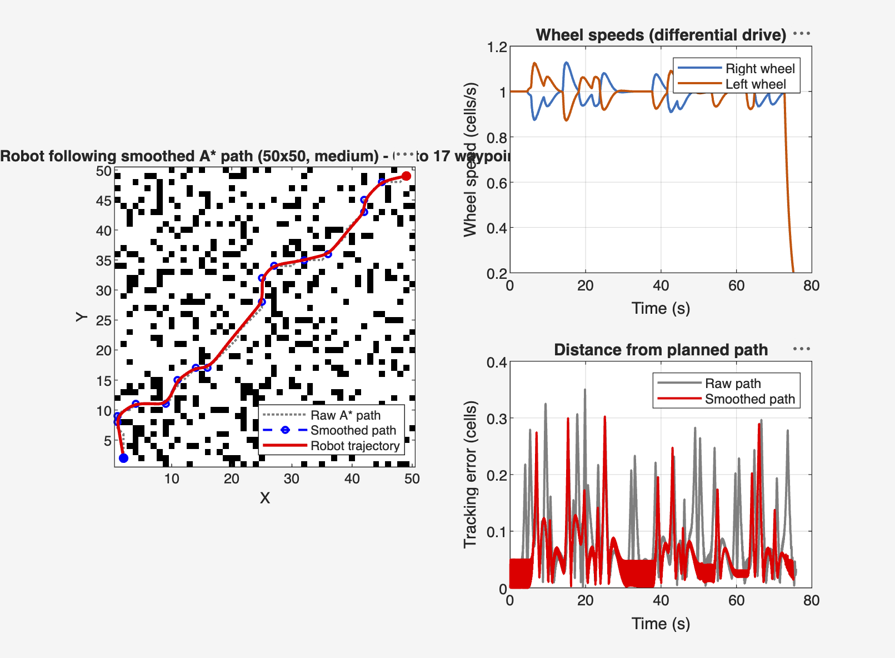
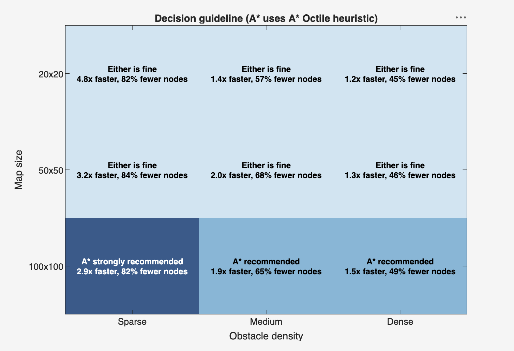

# A* vs Dijkstra: Path Planning for Autonomous Mobile Robots

A MATLAB benchmark comparing **Dijkstra's algorithm** and **A\*** for grid-based mobile robot path planning. It runs both planners on 45 seeded random maps, tests three A* heuristics, compares two open-list data structures, and drives a simulated two-wheeled robot along the planned path.

> Course project, **Robotics and Automation (BECE312L)**, School of Electronics Engineering, VIT Chennai
> Faculty: Dr. Bharathi Sankar

| Team member | Register number |
|---|---|
| Dhanya S | 23BEC1432 |
| Nithujaa J | 23BEC1354 |
| Sri Nithi Sathiyamoorthy | 23BEC1440 |


*Cells explored on the same map. Light blue: explored by Dijkstra only. Orange: explored by both.*

---

## Research question

**How much better is A\* than Dijkstra, under which conditions, and which version of A\* should a robot use?**

## Key results

| Finding | Result |
|---|---|
| A* (admissible heuristic) path vs Dijkstra | Same shortest path on **45 / 45** maps |
| Fewer nodes expanded by A* (Euclidean) | **36–78 %** |
| Speed-up on large open maps (100×100, sparse) | **3.2×** |
| Best heuristic for 8-direction movement | **Octile**: about 27 % fewer nodes than Euclidean, still optimal |
| Manhattan heuristic (not admissible with diagonals) | Longer path on **76 %** of maps, up to 5.84 % longer |
| Binary heap vs linear-scan open list | About **13–20× faster**, identical paths |
| Robot simulation | Differential-drive robot reaches the goal along the smoothed path |

### Benchmark: Dijkstra vs A* (Euclidean), mean of 5 maps per configuration

| Map | Density | Dijkstra nodes | A* nodes | Node reduction | Dijkstra (ms) | A* (ms) | Speed-up | Path length |
|---|---|---:|---:|---:|---:|---:|---:|---:|
| 20×20 | Sparse | 357 | 80 | 77.5 % | 0.77 | 0.40 | 1.93× | 25.68 |
| 20×20 | Medium | 320 | 166 | 48.3 % | 0.44 | 0.32 | 1.39× | 28.26 |
| 20×20 | Dense | 271 | 160 | 40.9 % | 0.32 | 0.21 | 1.53× | 32.16 |
| 50×50 | Sparse | 2248 | 634 | 71.8 % | 5.00 | 1.64 | 3.05× | 70.92 |
| 50×50 | Medium | 1987 | 933 | 53.1 % | 3.95 | 1.95 | 2.03× | 77.23 |
| 50×50 | Dense | 1683 | 1070 | 36.4 % | 3.42 | 2.26 | 1.52× | 86.57 |
| 100×100 | Sparse | 9013 | 2824 | 68.7 % | 58.10 | 18.09 | 3.21× | 145.97 |
| 100×100 | Medium | 7983 | 3945 | 50.6 % | 51.41 | 25.42 | 2.02× | 155.57 |
| 100×100 | Dense | 6858 | 4187 | 38.9 % | 44.31 | 27.08 | 1.64× | 172.04 |

Timings were measured in MATLAB on a laptop and are meant for comparing the two planners, not as absolute figures. Runs under 1 ms are mostly overhead.

---

## Method

- **Environment:** N × N occupancy grid with 8-connected motion. Straight moves cost 1 and diagonal moves cost √2. A diagonal move is blocked if it would squeeze between two obstacles.
- **Maps:** 3 sizes (20×20, 50×50, 100×100) × 3 obstacle densities (10 %, 20 %, 30 %) × 5 seeded random maps = 45 maps. Start (2, 2), goal (N−1, N−1).
- **Planners:** one shared `gridSearch` function. Dijkstra is A* with h = 0, so the heuristic is the only difference between them.
- **Heuristics:** Euclidean, Octile, Manhattan.
- **Metrics:** path length, planning time (median of 3 runs), nodes expanded, memory, and path excess over the optimum.
- **Robot:** line-of-sight path smoothing, then a differential-drive (unicycle) model tracking the path with a pure-pursuit controller.



---

## Repository structure

```
.
├── matlab/
│   ├── demo_single_map.m            # Proof of concept: both planners on one 20×20 grid
│   ├── benchmark_astar_dijkstra.m   # 45-map benchmark, Dijkstra vs A* (Euclidean), optimality check
│   ├── full_analysis.m              # Heuristics, heap vs linear open list, robot simulation, guideline
│   └── robotics_dashboard.m         # Interactive MATLAB app showing all results
├── dashboard/
│   └── index.html                   # Offline browser dashboard (no install, no internet)
├── results/
│   └── figures/                     # Figures used in the report
└── docs/
    ├── Project_Report.pdf           # Full project report
    └── Final_Presentation.pptx      # Final review slides
```

## How to run

**Requirements:** MATLAB R2020b or newer. No toolboxes are needed.

1. Clone or download this repository and open the `matlab` folder in MATLAB.
2. Run the scripts:

| Script | What it does | Output folder |
|---|---|---|
| `demo_single_map` | Runs both planners on one grid and plots the two paths | none (figure only) |
| `benchmark_astar_dijkstra` | Runs the 45-map benchmark and prints the results table | `review2_results/` |
| `full_analysis` | Runs the heuristic comparison, open-list timing, robot animation (GIF) and decision guideline | `review3_results/` |
| `robotics_dashboard` | Opens an interactive app. Click **Run full benchmark** | none (app) |

Each script takes from a few seconds to about a minute. All maps are seeded, so the results can be reproduced.

### Offline web dashboard

Download `dashboard/index.html` and open it in any browser. It reruns the benchmark in the browser and has a **Live planner** tab where you can draw walls, move the start and goal, and watch Dijkstra and A* search side by side. Because it uses its own random maps, its numbers differ slightly from MATLAB's, but the conclusions are the same.

---

## Results

| | |
|---|---|
|  |  |
| Nodes expanded and planning time against map size | Node reduction and speed-up for all 9 configurations |
|  |  |
| Nodes saved by each A* heuristic | Manhattan heuristic: path penalty and how often it is not optimal |
|  |  |
| Binary heap vs linear-scan open list | Robot following the smoothed A* path |

### Decision guideline



- **Small maps:** either algorithm is fine, because both plan in about a millisecond.
- **Large maps:** use A* with the **Octile** heuristic. It is most valuable on large, open maps.
- **Many goals at once** (for example, choosing the nearest of several charging docks): Dijkstra is the better choice, because one run gives the distance to every cell.
- **Avoid Manhattan** when diagonal moves are allowed.

---

## References

1. E. W. Dijkstra, "A note on two problems in connexion with graphs," *Numerische Mathematik*, vol. 1, pp. 269–271, 1959.
2. P. E. Hart, N. J. Nilsson and B. Raphael, "A formal basis for the heuristic determination of minimum cost paths," *IEEE Trans. Syst. Sci. Cybern.*, vol. 4, no. 2, pp. 100–107, 1968.
3. J. Pearl, *Heuristics: Intelligent Search Strategies for Computer Problem Solving*. Addison-Wesley, 1984.
4. N. R. Sturtevant, "Benchmarks for grid-based pathfinding," *IEEE Trans. Comput. Intell. AI Games*, vol. 4, no. 2, pp. 144–148, 2012.
5. R. C. Coulter, "Implementation of the pure pursuit path tracking algorithm," CMU-RI-TR-92-01, Carnegie Mellon University, 1992.
6. R. Siegwart, I. R. Nourbakhsh and D. Scaramuzza, *Introduction to Autonomous Mobile Robots*, 2nd ed. MIT Press, 2011.

The full reference list is in the [project report](docs/Project_Report.pdf).
